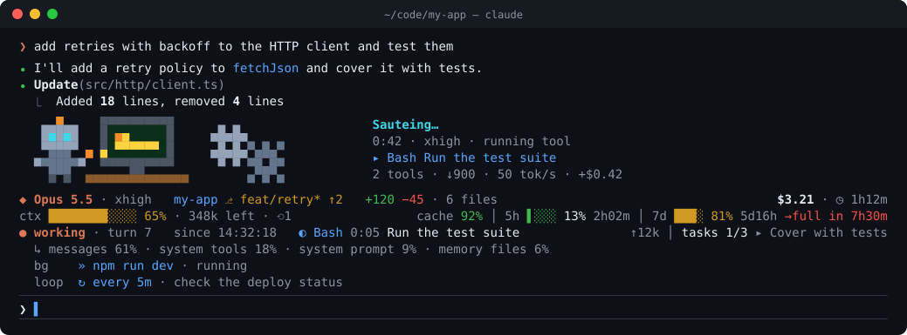
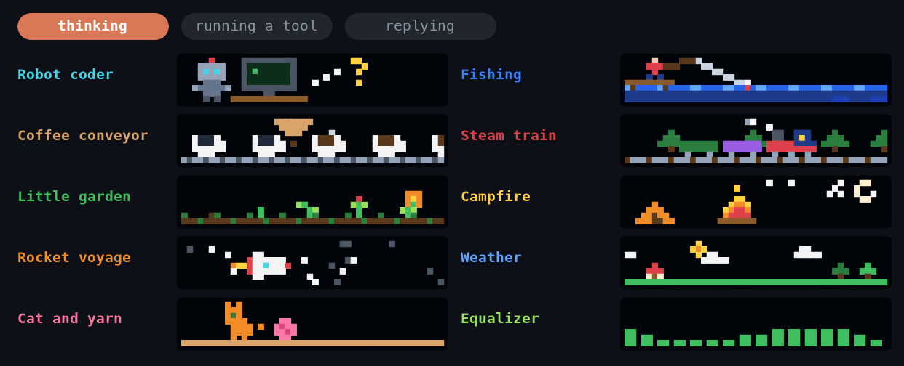
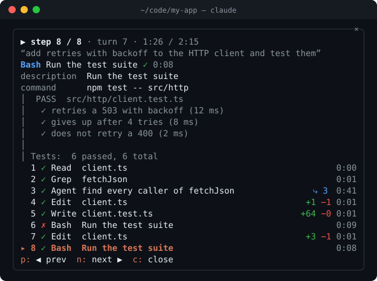
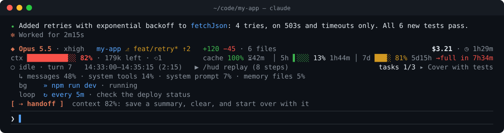

<div align="center">

# 🕹️ hudcade

**A pixel-art HUD for Claude Code.**

Context, cost, cache, agents and rate limits at a glance,<br>
a step-by-step replay of every turn, a one-click handoff when context runs low,<br>
and little 8-bit scenes that play while Claude thinks.

[](LICENSE)
[](https://code.claude.com)
[](#how-it-works)
[](#requirements)

English · [繁體中文](README.zh-TW.md)



</div>

## Why hudcade

Claude Code shows you the conversation. hudcade shows you everything happening around it.

- **💸 Know what a turn costs while it runs.** Session cost, what this turn has added so far, and how close you are to the 5-hour and 7-day limits, with reset countdowns and a warning when your pace would hit one before it resets.
- **🧠 See context filling up before auto-compact hits.** A colored context bar with tokens left, how often the session has compacted, and, once you pass the warning line, what is eating the window.
- **⚡ Catch a broken prompt cache, and keep a warm one.** Hit ratio for the session. The last request is flagged when it missed, and a resumed session whose cache has expired says so, with the cost of rebuilding it. While you are idle, a countdown shows how long the cache still holds the conversation, with a toast five minutes before it runs out.
- **🤖 Keep track of your agents.** A live line under each running Agent call, a pane with every agent and its task, and rows for agent-team teammates, background shells and scheduled loops.
- **⏪ Replay a turn.** Step through what the last turn did, call by call: the arguments, the outcome, the start of what each call answered, the diff an edit asked for, and each subagent's own calls.
- **🔁 Hand off before context runs out.** One button saves a summary of where the work stands, clears the conversation and starts over with the summary.
- **🕹️ Make waiting fun.** The spinner becomes one of ten little 8-bit scenes that react to what Claude is doing.
- **📱 Walk away.** A Telegram message when a turn finishes, when Claude needs your approval, when a turn fails, or when the background agents it left running are all done.

## Install

In a Claude Code terminal session:

```
/plugin install hudcade --marketplace g761007/hudcade
```

1. Answer `y` to add the marketplace.
2. Pick the user scope.
3. Fill in the options you want. Leave the Telegram fields empty if you don't want notifications.

The HUD shows up right away, in every session from then on, including those the desktop app starts on the same machine.

If you used a `statusLine` command before, you can remove it from `~/.claude/settings.json`. The HUD band shows the same and more.

<details>
<summary>Prefer the CLI?</summary>

```sh
claude plugin marketplace add g761007/hudcade
claude plugin install hudcade@hudcade
```

</details>

## What you get

### The HUD band

Above the prompt, in the terminal and in the desktop app. Each row has a left and a right side. On a narrow terminal the least important parts drop out first.

| Row | What it tells you |
|---|---|
| **Identity** | Model and effort · project and branch (dirty, ahead/behind) · lines added and removed and files edited this session · session cost, what this turn added, session time |
| **Capacity** | Context bar, tokens left and compactions · prompt-cache hit ratio, and while idle how long the cache still holds the conversation, counted from the main conversation's last request (`⏳42m`; amber, with a toast, in its last five minutes; then, in red, `cache expired · next prompt rebuilds it`) · 5-hour and 7-day limits with reset countdowns, and a forecast once your pace heads past 75% (`→92%`, or `→full in 50m`) |
| **Activity** | Working, waiting for your approval, or idle (interrupted or failed, when the last turn ended so) · turn number, start time (and end time once done) · the tool running now · tokens in and out this turn · output speed · tool calls and failures · task progress · once a turn that called tools has ended, `▶ /hud replay (8 steps)` |
| **Step recap** | One line on what the turn is doing, written by a small model as its steps go by. Off unless you turn on `recap`. |
| **Context breakdown** | The largest parts of the window. Only appears once context passes the warning threshold. |
| **Workers** | Teammates, background tasks and loops, while there are any. Subagents are in Claude Code's own list under the prompt. |
| **Handoff** | Once context reaches `handoffPercent`, while idle: a `⇢ handoff` button. While a handoff runs, the step it is on. |

While hudcade's spinner runs in the terminal, the band leaves it the turn's clock, output tokens, speed, tool calls and cost, so nothing shows twice.

Toasts warn you when context crosses its thresholds, five minutes before the prompt cache runs out, and before a model switch that would throw away a warm prompt cache. The model-switch toast includes what rebuilding the cache will cost.

### Subagents

Claude Code lists running subagents under the prompt. hudcade adds what that list leaves out. Under each Agent call in the transcript, while the agent runs, a dim line shows its model, the time it spent working, its tool calls and the tool in hand, its context share and a sparkline of its tokens. `/hud agents` opens a pane with every agent of the session and its task. A row there turns ✓ when the run completes, ✗ when it fails and ⏹ when it is stopped, and goes a minute later.

Agents a workflow starts, forks and resumed agents get rows of their own.

### Step recap

With `recap` on, after Claude's tool steps a small model (`haiku` by default) reads the prompt, the steps so far and Claude's latest note, and writes one line on where the turn stands:

```
  ↳ Fixing the agent-row linking; 65 of 65 tests pass after the change
```

It makes at most one call every 10 seconds and only while a turn runs. Each call is billed to your session like any other request, and counts in its cost. It writes in the language your notifications use.

### The pixel spinner



While Claude works, the spinner turns into a little 8-bit scene, a different one each turn. Every scene reacts to what Claude is doing:

| Scene | Thinking | Running a tool | Replying |
|---|---|---|---|
| **Robot coder** | The antenna blinks, a question forms | A progress bar fills, gears turn, sparks fly | It types; bits stream out of the screen |
| **Coffee conveyor** | Mugs roll under a slow drip | A kettle pours, the drip speeds up | The belt speeds up, every mug steams |
| **Little garden** | Plants sprout and sway | A watering can flies over | Everything blooms, butterflies arrive |
| **Rocket voyage** | Cruising among the stars | Collecting energy crystals | Warp speed |
| **Cat and yarn** | The cat sits, tail swishing | It pounces, the yarn unrolls | A full-speed chase |
| **Fishing** | The bobber bobs, fish swim below | A bite and a splash | Fish leap out of the water |
| **Steam train** | Puffing through the trees | The cars load cargo | Full steam ahead |
| **Campfire** | Small flames under the stars | A log goes in, the fire flares | A marshmallow toasts |
| **Weather** | Sun and drifting clouds | Storm clouds, rain and lightning | A rainbow and birds |
| **Equalizer** | A low, gentle wave | Pulses on the beat | Peaks in the red |

Next to the scene are the spinner word, the elapsed time, the effort, the current activity, and what the turn has done so far: tool calls, output tokens, speed and cost (`2 tools · ↓900 · 50 tok/s · +$0.42`). Pin one scene with the `spinnerScene` option.

The spinner is terminal only; the desktop app keeps its own.

### Turn replay



When a turn that called tools ends, the idle band offers `▶ /hud replay (8 steps)`. `/hud replay` opens a pane on the turn's first tool call. You move through the steps yourself: `n` and `p`, or press a step in the list. Past the last step is a summary: how the turn ended, its steps, failures and agents, and the lines its edits changed.

For each step the pane shows its tool and file, ✓, ✗ (failed or refused) or ⏹ (still running when the turn ended), how long it took and when in the turn it ran, and what you asked. Under it are the call's arguments in full, wrapped (a command, a path from the project's root, a pattern), and the start of what it answered, or why it was refused. On the summary, the files the turn's edits changed are listed with their lines. An Edit or Write shows the lines it adds and removes (`+12 −3`); `d` opens its diff, with line numbers and highlighting, and `n` and `p` then go from one change to the next. The step and its change are noted as the call starts, read from the file as it was, so a refused or failed edit still shows what it meant to change.

A subagent's calls are on a track of their own. Its Agent call's step shows how many it made (`⤷ 12`); `a` goes into that track, to move through and open diffs the same way. A background agent's calls after the turn ended join its track. `b` or Escape goes back out of a diff or a track; `c`, or Escape on the main line, closes the pane.

The pane takes as much room as Claude Code gives one: docked beside a fullscreen transcript, 45% of the terminal wide and its full height; above the prompt, about a third of the screen. It fills that room: what you asked, the step's arguments and answer, and as many steps as fit (up to twenty). Short of rows, the answer gives way first, then the arguments, so that three steps stay listed. A diff takes the whole pane.

A turn that called no tool leaves the last replay as it was. The last replay of each project is also kept on disk, so it outlives a restart, a `/clear` or the conversation moving to a new session: `/hud replay` opens it there, marked as from an earlier session.

### One-click handoff



Once context reaches `handoffPercent` (80% by default; `/hud handoff-at 70` sets it from the prompt), the idle band offers a `⇢ handoff` button (`h` once the band has the keys, or a click). Pressed, or run as `/hud handoff` at any time:

1. A fork of the conversation writes a handoff summary under five headings: the goal, what is done, what is not done yet, the files changed, and what to watch out for. The fork reads the conversation from the prompt cache and adds nothing to it.
2. The summary is saved to `~/.claude/handoffs/<project>/<date>-<time>-handoff.md`.
3. The conversation is cleared, and the summary, with the file's path, is sent as the new conversation's first prompt.

While it runs, the band says which step it is on. If no summary comes, or it cannot be saved, the conversation is left as it was.

### Telegram notifications

```
✅ Claude Code is done
Project: my-app (feat/retry)
Time: 2026-10-08 14:34:19 CST
Took 2m14s · Opus 5.5 · xhigh · $3.21
5h:13%(2h02m) wk:81%(5d16h) ctx:65%(opus)
Summary: Added a retry policy with exponential backoff and covered it with 6 tests.
Session: 11fa1a35
```

Messages are sent in four cases:

- **A turn completes.** Turns you interrupt and subagent turns are skipped.
- **A permission prompt is waiting.**
- **A turn fails**, for example on a rate limit.
- **The background agents a turn left running have all ended**, while you are idle. The message lists each one and how it ended. It is skipped if you start another turn first.

Messages come in English or Traditional Chinese. By default they follow Claude Code's own `language` setting. The bot token stays in Claude Code's secure storage and never appears in a log.

## Configuration

Everything lives in `/config`, or run `claude plugin configure hudcade`:

| Option | Default | Meaning |
|---|---|---|
| `hud` | `true` | The HUD band |
| `spinner` | `true` | The pixel spinner (terminal) |
| `spinnerScene` | `random` | `random`, or one of `robot`, `coffee`, `garden`, `rocket`, `cat`, `fishing`, `train`, `campfire`, `weather`, `equalizer` |
| `ctxWarnPercent` / `ctxCriticalPercent` | `60` / `80` | Context thresholds for colors, toasts and the breakdown row |
| `handoffPercent` | `80` | Context usage from which the band offers a one-click handoff; `/hud handoff-at` sets it over this option |
| `recap` | `false` | The step recap row: a small model sums up the running turn (billed to your session) |
| `recapModel` | `haiku` | Model alias or id that writes the step recap |
| `notify` | `true` | Telegram notifications |
| `notifyMinTurnSeconds` | `0` | Skip completion messages for shorter turns; `0` sends every turn |
| `notifyBlocklist` | empty | Project folder names that never notify, separated by spaces |
| `notifyLanguage` | `auto` | `auto` follows Claude Code's `language` setting (Chinese there means Traditional Chinese, anything else English); or `en`, `zh-TW` |
| `telegramBotToken` / `telegramChatId` | — | Your bot and chat. When unset, `~/.claude/hooks/.telegram.env` (`TELEGRAM_BOT_TOKEN`, `TELEGRAM_CHAT_ID`) is read if it exists |

Per project, `.claude/claude-mods.json` (shared with the team) and `.claude/claude-mods.local.json` (just you) override any option except the Telegram credentials:

```json
{ "notify": false, "spinnerScene": "campfire" }
```

Commands:

- `/hud`: what is switched on, where the settings came from, and what the HUD has read, including what the cache countdown counts from: `cache=1h · last main request sent 16:02:11 · expires 17:02:11 (in 42m)`.
- `/hud agents`: open the agents pane.
- `/hud replay`: replay the last turn that called tools.
- `/hud handoff`: save a handoff summary, clear the conversation, and start over with the summary.
- `/hud handoff-at <percent>`: show the handoff button from this context share (1 to 100), kept across sessions; with no number, say what it is; `default` goes back to the `handoffPercent` option.
- `/hud test-notify`: send a test Telegram message.

## How it works

hudcade is a **mod**: a plugin of function hooks that runs inside Claude Code itself.

- **No statusline script.** Nothing is spawned on every refresh, and no transcript files are parsed.
- **It reads the engine directly.** Usage, cost and rate limits come from `$.session.usage()`. Tool calls, subagents and tasks come from `tool.call` and the session events. Tokens, cache reads and output speed come from the model's own response stream.
- **The drawing goes through Claude Code's UI.** The band is drawn with the UI's elements. The scenes are a `Raster` repainted about twelve times a second while a turn runs, and only then.
- **Actions go through the engine too.** The replay notes each tool call at `tool.call`, before it runs. The handoff summary comes from `$.model.fork`, which reads the conversation from the prompt cache without adding to it; the clear and the first prompt go through `$.command.run` and `$.prompt.submit`. The last replay of each project, and a threshold set with `/hud handoff-at`, are kept in the mod's own store.
- **The logic is plain TypeScript, separate from the hooks.** The HUD model, the layout, the scenes and the messages are pure functions, covered by tests that also mount the band on the terminal and desktop surfaces.

## Requirements

- Claude Code **2.1.329** or newer (the hooks use `agent.report`, `tool.run` and `tool.judge`). Mods are on by default from 2.1.287; their API is still marked early access.
- macOS or Linux, with `git` and `date` on `PATH`.
- A Telegram bot, only if you want notifications.

## Known limits

- **Background tasks and loops** refresh when a turn ends. One that finishes while you are idle stays listed until the next turn.
- **The rate-limit forecast** uses the pace since the window opened, so a burst after a quiet stretch shows up slowly. It appears once a tenth of the window has gone by.
- **Lines added and removed** count Edit and Write changes, not files changed through shell commands.
- **Output speed** counts from the first streamed chunk, thinking included.
- **Before the first reply** of a session, Claude Code has no context or rate-limit readings yet. The band says so instead of showing zeros.
- **On Team and Enterprise plans**, Claude Code's built-in `cc-plugin-sec-default` runs ahead of every installed plugin and passes all classic hook events over, so hudcade's `classic.*` hooks never run (Claude Code says so in a line per hook). Native events cover agent rows, compactions, the cache lifetime, permission prompts (inferred from the permission check, and sent after 1.5 seconds) and `/clear`. Nothing native carries the session title, background tasks and loops, the model-switch toast or a resumed session's cold cache, so those stay empty there.
- **Hooking tool calls** turns off Claude Code's move of a running tool to the background (Ctrl+B) while the mod is loaded.
- **The replay** keeps the last turn that called tools, per project. What a call answered is cut to 40 lines and a diff to 300 lines. A diff is worked out from the file as it stood before the call; an Edit whose text is not in the file shows its own two texts instead.
- **The handoff button** takes a click, or the keyboard once the band has it (Ctrl+X, then Tab, then `h`).
- **`/hud handoff-at`** applies to every project, over a project's own `handoffPercent`. `/hud handoff-at default` lifts it.

## Troubleshooting

- **Nothing shows.** Run `/hud` to see what the HUD has read and any reading that failed. For more detail, start `claude --debug` and look for lines starting with `hudcade:`.
- **No Telegram message.** `/hud` tells you whether Telegram is configured. Then try `/hud test-notify`.
- **`/hud replay` says there is nothing to replay.** The mod records a turn as it runs, so a turn that called tools has to end after the mod loaded. A session with no replay of its own opens the project's last one, from an earlier session.
- **A handoff stopped.** The toast says why. Until the summary is saved, the conversation is left as it was; after that, the toast names the file.

## Development

```
.claude-plugin/marketplace.json   the marketplace
plugin/                           the mod
  .claude-plugin/plugin.json      manifest and options
  hooks/register.tsx              every hook
  src/core/                       pure logic: HUD model, band layout, config, messages, replay, diffs, handoff
  src/core/scenes/                one file per spinner scene
  types/index.d.ts                the session-state contract
  tests/                          unit and drawing tests
scripts/render-assets.ts          renders assets/ from the mod's own code
```

```sh
tsc -p plugin                             # type-check (TypeScript 5.4+)
claude plugin validate plugin --strict    # what the engine would refuse
claude plugin test plugin                 # tests, terminal and desktop surfaces
claude --plugin-dir ./plugin              # run your working copy; saving a file reloads it
bun scripts/render-assets.ts              # regenerate the README images (Bun + ImageMagick)
```

To run the working copy in every session, the desktop app's included, put its absolute path in `CLAUDE_CODE_PLUGIN_DIRS` in the `env` block of `~/.claude/settings.json`, and turn the installed copy off so it does not load twice. A terminal session then reloads the mod whenever a file in it is saved.

All hooks live in one file because of two engine rules:

- A module registers one hook per event.
- The engine follows `$` only into functions declared in the same file.

The editor and `tsc` read the API declarations from `plugin/.claude-plugin/types/`. The engine writes that folder whenever it loads the mod. Before the first load, copy it from the `plugin-authoring` skill's `types/claude-code.d.ts`.

## Contributing

Issues and pull requests are welcome, especially new scenes, new HUD rows and notification channels beyond Telegram.

A scene is one file in `plugin/src/core/scenes/`: a `draw(canvas, mode, t)` function that paints an 8-pixel-tall frame for the `think`, `tool` and `reply` moods. Register it in `scenes/index.ts`, add its name to `SceneName` and to the `spinnerScene` options, and the tests check that it draws in every mood and at every width.

Please run the three checks above before opening a PR.

## Disclaimer

hudcade is an independent community project. It is not affiliated with, endorsed by or sponsored by Anthropic. Claude and Claude Code are trademarks of Anthropic, PBC.

## License

[MIT](LICENSE)
