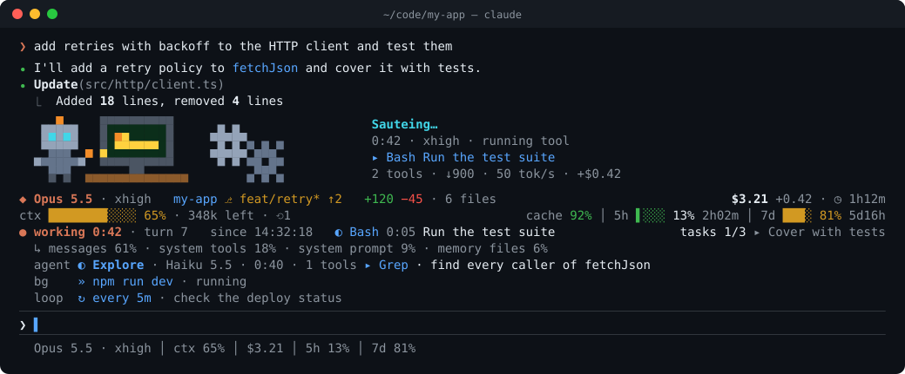
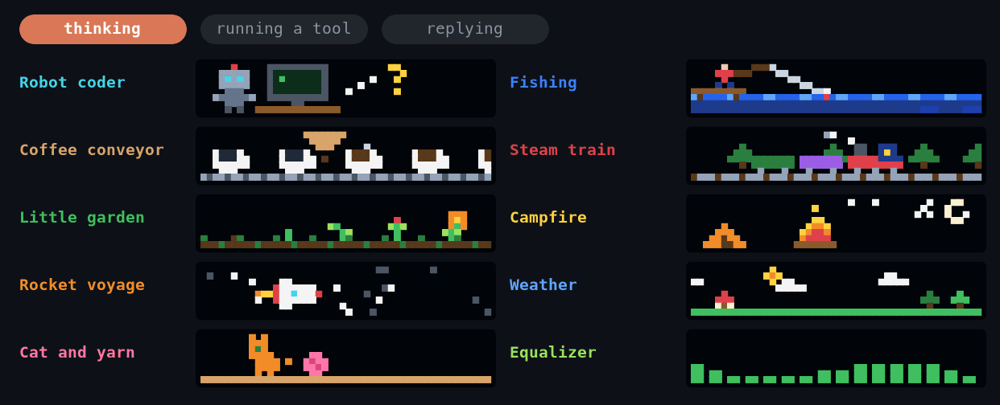

<div align="center">

# 🕹️ hudcade

**Claude Code 的像素風 HUD。**

context、成本、快取、agent、用量上限一眼看完，<br>
Claude 思考的時候，還有 8-bit 小動畫陪你等。

[](LICENSE)
[](https://code.claude.com)
[](#運作方式)
[](#系統需求)

[English](README.md) · 繁體中文



</div>

## 為什麼需要 hudcade

Claude Code 顯示的是對話內容；hudcade 讓你看到對話以外的所有狀況。

- **💸 回合還在跑，就知道花了多少錢**：session 累計成本、這回合目前增加的金額，以及距離 5 小時、7 天用量上限還有多遠，附重置倒數。
- **🧠 自動壓縮前就看到 context 快滿了**：彩色進度條顯示剩餘 token 和壓縮次數。超過警告線後，還會列出是哪些內容在佔用 context。
- **⚡ 快取失效馬上發現**：顯示整個 session 的 prompt 快取命中率，最近一次沒命中時會特別標出來。resume 時如果快取已經過期，也會直接告訴你，並附上重建快取的費用。
- **🤖 所有工作者一次掌握**：subagent（含 model 和正在用的工具）、Agent Teams 隊友、背景指令、排程，各自一行。
- **🕹️ 等待也變有趣**：等待動畫換成 10 組 8-bit 小場景之一，畫面會跟著 Claude 正在做的事變化。
- **📱 放心離開座位**：回合完成、需要你確認權限、或回合失敗時，都會發 Telegram 通知給你。

## 安裝

在 Claude Code 的終端機 session 中輸入：

```
/plugin install hudcade --marketplace g761007/hudcade
```

1. 詢問是否加入外掛市集時，回答 `y`。
2. 範圍選擇 user scope。
3. 填寫想要的選項。不需要通知的話，Telegram 欄位留空即可。

裝好就立刻生效，之後每個 session 都會出現，包括桌面版 app 在同一台電腦上啟動的 session。

如果你以前設定過 `statusLine` 指令，可以把它從 `~/.claude/settings.json` 移除，hudcade 會畫自己的狀態列。

<details>
<summary>想用 CLI 安裝？</summary>

```sh
claude plugin marketplace add g761007/hudcade
claude plugin install hudcade@hudcade
```

</details>

## 功能一覽

### HUD 資訊列

固定在輸入框上方，終端機和桌面版 app 都看得到。每一行分成左右兩側；終端機比較窄時，最不重要的部分會先被省略。

| 行 | 顯示內容 |
|---|---|
| **身分** | model 與 effort · 專案與 branch（是否有未提交的修改、領先或落後幾個 commit）· 這個 session 增刪的行數與修改過的檔案數 · session 成本、這回合增加的金額、session 時長 |
| **容量** | context 進度條、剩餘 token、壓縮次數 · prompt 快取命中率 · 5 小時與 7 天用量上限及重置倒數 |
| **活動** | 工作中、等待你確認權限或閒置 · 回合數、開始時間（結束後顯示開始與結束時間）· 正在執行的工具 · 本回合送出與收到的 token · 輸出速度 · 工具呼叫次數與失敗數 · task 進度 |
| **context 組成** | 佔用 context 最多的幾個部分。只在超過警告門檻時出現 |
| **工作者** | subagent、隊友、背景任務、排程。有資料時才出現 |

context 超過門檻時，會跳出提示提醒你。切換 model 會讓仍然有效的 prompt 快取失效時，也會先提醒你，並附上重建快取的費用。

### 狀態列

輸入框下方的精簡版，只想看重點時剛好：

```
Opus 5.5 · xhigh │ ctx 41% │ $3.21 │ 5h 13% │ 7d 38%
```

### 像素等待動畫



Claude 工作時，等待動畫會換成一組 8-bit 小場景，每回合都會換一組。每組場景都會隨 Claude 目前的狀態改變畫面：

| 場景 | 思考中 | 執行工具 | 輸出回覆 |
|---|---|---|---|
| **機器人寫程式** | 天線閃爍、冒出問號 | 進度條前進、齒輪轉動、迸出火花 | 快速打字，資料從螢幕飛出 |
| **咖啡輸送帶** | 杯子慢慢經過滴漏 | 水壺注水，滴得更快 | 輸送帶加速，每杯都冒蒸氣 |
| **小花園** | 植物發芽、隨風搖曳 | 澆水壺飛過灑水 | 全部開花，蝴蝶飛來 |
| **火箭航行** | 星空巡航 | 收集能量水晶 | 曲速飛行 |
| **貓咪與毛線球** | 貓坐著甩尾巴 | 撲向毛線球，毛線被拉開 | 全速追逐 |
| **碼頭釣魚** | 浮標輕晃，水下魚影游過 | 魚咬鉤，濺起水花 | 魚躍出水面 |
| **蒸汽火車** | 穿過樹林，冒出煙圈 | 車廂裝上貨物 | 全速前進 |
| **夜晚營火** | 星空下的小火 | 丟進木柴，火勢變大 | 烤棉花糖 |
| **天氣** | 晴天，雲朵飄過 | 烏雲、下雨、閃電 | 彩虹與鳥群 |
| **音樂等化器** | 低而柔和的波浪 | 跟著節拍跳動 | 能量全開，峰值破表 |

場景旁邊會顯示以下資訊：
- 動詞
- 經過時間
- effort
- 目前的動作
- 這回合到目前為止的工具次數、輸出 token、速度和花費（`2 tools · ↓900 · 50 tok/s · +$0.42`）

想固定只播某一組，可以用 `spinnerScene` 選項指定。

等待動畫只在終端機出現，桌面版 app 維持原本的樣子。

### Telegram 通知

```
✅ Claude Code 完成回覆
專案：my-app (feat/retry)
時間：2026-10-08 14:34:19 CST
耗時 2m14s · Opus 5.5 · xhigh · $3.21
5h:13%(2h02m) wk:81%(5d16h) ctx:65%(opus)
摘要：Added a retry policy with exponential backoff and covered it with 6 tests.
Session：11fa1a35
```

以下三種情況會發通知：

- **回合完成**：你中斷的回合和 subagent 的回合不會通知。
- **需要你確認權限**。
- **回合失敗**：例如觸發用量上限。

bot token 存放在 Claude Code 的安全儲存區，不會出現在任何 log 中。

## 設定

所有選項都在 `/config` 中，也可以執行 `claude plugin configure hudcade`：

| 選項 | 預設值 | 說明 |
|---|---|---|
| `hud` | `true` | HUD 資訊列 |
| `statusLine` | `true` | 輸入框下方的狀態列 |
| `spinner` | `true` | 像素等待動畫（終端機） |
| `spinnerScene` | `random` | `random`，或 `robot`、`coffee`、`garden`、`rocket`、`cat`、`fishing`、`train`、`campfire`、`weather`、`equalizer` 其中一組 |
| `ctxWarnPercent` / `ctxCriticalPercent` | `60` / `80` | context 的警告與危險門檻，影響顏色、跳出提示和 context 組成行 |
| `notify` | `true` | Telegram 通知 |
| `notifyMinTurnSeconds` | `0` | 比這個秒數短的回合不發完成通知；`0` 表示每回合都發 |
| `notifyBlocklist` | `observer-sessions` | 永遠不發通知的專案資料夾名稱，以空格分隔 |
| `telegramBotToken` / `telegramChatId` | — | 你的 bot 與聊天室。未設定時，若 `~/.claude/hooks/.telegram.env`（`TELEGRAM_BOT_TOKEN`、`TELEGRAM_CHAT_ID`）存在就會讀取 |

每個專案都可以用兩個檔案覆寫 Telegram 憑證以外的任何選項：

- `.claude/claude-mods.json`：團隊共用
- `.claude/claude-mods.local.json`：只對你自己生效

```json
{ "notify": false, "spinnerScene": "campfire" }
```

指令：

- `/hud`：顯示哪些功能已開啟、設定來源，以及 HUD 目前讀到的資料。
- `/hud test-notify`：發送一則 Telegram 測試訊息。

## 運作方式

hudcade 是一個 **mod**，也就是由 function hooks 組成、直接在 Claude Code 內部執行的外掛。

- **不需要 statusline 腳本**：不會每次重繪都啟動一個新程序，也不必解析 transcript 檔案。
- **直接讀取引擎的資料**：
  - 用量、成本、用量上限：來自 `$.session.usage()`
  - 工具呼叫、subagent、task：來自 `tool.call` 和 session 事件
  - token、快取讀取量、輸出速度：來自模型本身的回應串流
- **透過 Claude Code 的 UI 繪製**：資訊列和狀態列都用 Claude Code 自己的 UI 元件繪製。場景是一個 `Raster`，只在回合進行中才會每秒更新約十二次。
- **邏輯與 hooks 分開，全部是純 TypeScript**：HUD 狀態、版面、場景和通知訊息都是純函式，並有測試涵蓋；測試也會實際在終端機和桌面版兩種畫面上 mount 資訊列。

## 系統需求

- Claude Code **2.1.290** 以上。mods 從 2.1.287 起預設開啟，但 API 仍標示為 early access。
- macOS 或 Linux，且 `PATH` 中有 `git` 和 `date`。
- 需要通知時，才需要準備 Telegram bot。

## 已知限制

- **背景任務與排程**：在回合結束時更新。如果任務在你閒置時結束，會一直顯示到下一回合結束。
- **增刪行數**：只計算 Edit 和 Write 的修改，不包含透過 shell 指令修改的檔案。
- **輸出速度**：從收到第一段串流內容開始計算，包含 thinking。
- **session 第一次回覆之前**：Claude Code 還沒有 context 和用量上限的數據，資訊列會直接說明這點，不會顯示 0。

## 疑難排解

- **畫面沒有出現任何東西**：執行 `/hud`，查看 HUD 讀到的資料和讀取失敗的項目。需要更多細節時，用 `claude --debug` 啟動，再找以 `hudcade:` 開頭的訊息。
- **沒有收到 Telegram 通知**：`/hud` 會顯示 Telegram 是否已設定，接著試試 `/hud test-notify`。

## 開發

```
.claude-plugin/marketplace.json   外掛市集
plugin/                           mod 本體
  .claude-plugin/plugin.json      外掛設定與選項
  hooks/register.tsx              所有 hook
  src/core/                       純邏輯：HUD 狀態、資訊列版面、設定、通知訊息
  src/core/scenes/                等待動畫場景，一組一個檔案
  types/index.d.ts                session 狀態的型別契約
  tests/                          單元測試與畫面測試
scripts/render-assets.ts          用 mod 本身的程式碼產生 assets/ 中的圖片
```

```sh
tsc -p plugin                             # 型別檢查（TypeScript 5.4+）
claude plugin validate plugin --strict    # 檢查引擎會拒絕的寫法
claude plugin test plugin                 # 測試，涵蓋終端機與桌面版畫面
claude --plugin-dir ./plugin              # 直接執行工作中的版本，存檔就會重新載入
bun scripts/render-assets.ts              # 重新產生 README 圖片（需要 Bun 與 ImageMagick）
```

所有 hook 都集中在同一個檔案裡，因為引擎有兩條規則：

- 同一個 module 中，每個事件只能註冊一個 hook。
- 引擎只會追蹤傳進同一檔案內函式的 `$`。

編輯器和 `tsc` 會從 `plugin/.claude-plugin/types/` 讀取 API 型別宣告。這個資料夾由引擎在每次載入 mod 時產生；第一次載入前，請從 `plugin-authoring` skill 的 `types/claude-code.d.ts` 複製一份過去。

## 參與貢獻

歡迎提 issue 和 pull request，尤其是新場景、新的 HUD 資訊，以及 Telegram 以外的通知管道。

新增一組場景的步驟：

1. 在 `plugin/src/core/scenes/` 新增一個檔案，寫一個 `draw(canvas, mode, t)` 函式，替 `think`、`tool`、`reply` 三種狀態各畫出一格 8 像素高的畫面。
2. 在 `scenes/index.ts` 註冊這組場景。
3. 把場景名稱加進 `SceneName` 和 `spinnerScene` 的選項。

完成後，測試會自動確認它在每種狀態、每種寬度下都能正常繪製。

送出 PR 前，請先跑過上面三項檢查。

## 免責聲明

hudcade 是獨立的社群專案，與 Anthropic 沒有任何隸屬、背書或贊助關係。Claude 與 Claude Code 是 Anthropic, PBC 的商標。

## 授權

[MIT](LICENSE)
